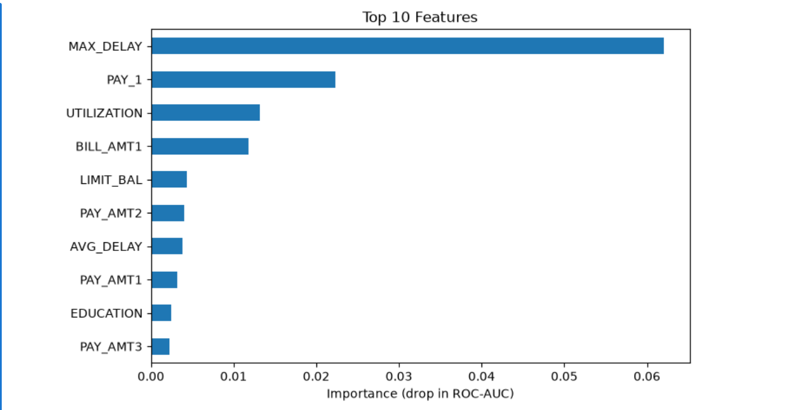

# Credit Card Default Risk Analysis

I made this project to understand how a bank can find out, in advance, which credit card customers are likely to miss their
payment next month. I came from a Political Science background, so this was also a project to practice the full machine
learning workflow on my own.

## Problem
When a customer defaults, the bank loses money. If the bank can spot risky customers early, it can send reminders or 
reduce their limit before the default happens.

## Dataset
UCI "Default of Credit Card Clients" dataset: 30,000 customers and 24 columns (credit limit, age, bill amounts, payment
history, etc.). Only about 22% of customers default, so the data is imbalanced.

## Tools
Python, Pandas, NumPy, Scikit-learn, Matplotlib, Jupyter Notebook

## What I Did
1. Cleaned the data (some EDUCATION and MARRIAGE values were invalid)
2. Created new features: AVG_DELAY, MAX_DELAY, UTILIZATION, PAY_RATIO
3. Handled the imbalance using class weights
4. Trained 3 models and compared them
5. Changed the decision threshold to catch more defaulters
6. Checked which features matter most (permutation importance)
7. Divided customers into Low, Medium and High risk groups

## Model Comparison

| Model | Accuracy | Precision | Recall | F1 | ROC-AUC |
|---|---|---|---|---|---|
| Logistic Regression | 0.72 | 0.41 | 0.63 | 0.50 | 0.725 |
| Random Forest | 0.80 | 0.54 | 0.48 | 0.51 | 0.761 |
| Gradient Boosting | 0.76 | 0.46 | 0.63 | 0.53 | 0.779 |

Random Forest has the best accuracy, but it catches only 48% of the defaulters. For a bank, missing a defaulter is more 
costly than a false alarm, so I chose Gradient Boosting (best ROC-AUC and 63% Recall).

## Threshold Tuning
With Random Forest, lowering the threshold from 0.5 to 0.35 raised Recall from 49% to 64%. The trade-off is that precision 
drops from 54% to 43%, so the bank has to decide how many false alarms it can handle.

## What Drives Default

- The worst payment delay in the last 6 months (MAX_DELAY) is the strongest sign of default.
- Three of the features I created (MAX_DELAY, UTILIZATION, AVG_DELAY) are in the top 10, so feature engineering helped the
model.

## Risk Groups

| Risk Level | Customers | Actual Default Rate |
|---|---|---|
| Low | 2114 | 8% |
| Medium | 2574 | 18% |
| High | 1312 | 54% |

High-risk customers default about 7 times more often than low-risk customers. They are only 22% of the test customers, but
they contain more than half of all defaulters.

## Suggestions for the Bank
- Send early payment reminders to High-risk customers and review their credit limits.
- Keep a close watch on customers who delay payments repeatedly.
- Low-risk customers can be considered for limit increases.

## Challenges I Faced
- XGBoost would not install on my system because of a slow internet connection, so I used Scikit-learn's
  HistGradientBoostingClassifier.
- My first model had good accuracy but low Recall. That made me learn why accuracy alone can be misleading on imbalanced
  data.

## Files
- Credit_Card_Default_Risk_Analysis.ipynb: full code and analysis
- UCI_Credit_Card.csv: dataset

## About Me
Varsha | Data Analyst Fresher

LinkedIn: [Varsha Tanwar](https://www.linkedin.com/in/varshatanwar)
